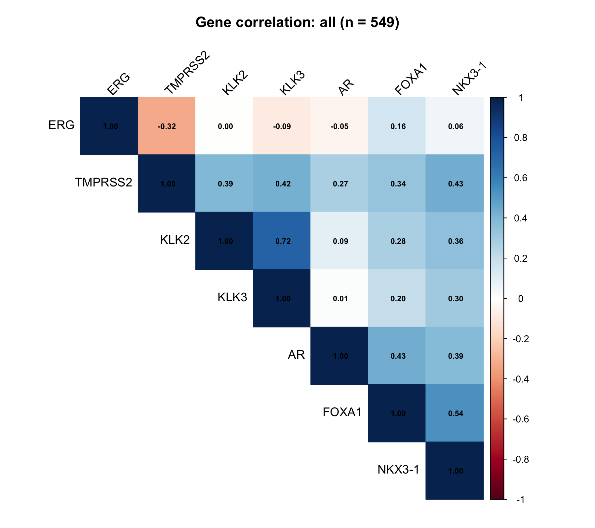

# Multi-Correlation Analysis

A containerized R application for category-specific gene-gene correlation analysis. It accepts a normalized counts table and matching sample metadata, then writes correlation, p-value, and false-discovery-rate (FDR) matrices with a heatmap for each selected category.

This is a standalone application for command-line, HPC, and future OncoChat use. It is intentionally distinct from `multi-gene-correlations`, which correlates individual genes with a signature score.

## Example output from real data

The figure below was generated with normalized bulk RNA-seq expression from the public [TCGA-PRAD project](https://portal.gdc.cancer.gov/projects/TCGA-PRAD). It shows pooled Spearman correlations across 549 matched samples for a small prostate-expression panel (`AR`, `FOXA1`, `KLK2`, `KLK3`, `NKX3-1`, `TMPRSS2`, and `ERG`). This is a workflow demonstration, not a prognostic or clinical claim.



The same run also produced separate category outputs for 496 primary tumor samples and 52 normal-tissue samples. Source details, parameters, sample accounting, and a reproducible command are in [the TCGA-PRAD example record](docs/examples/tcga-prad-7gene-panel.md). The repository includes only this derived figure; no TCGA input data are redistributed.

## Inputs

- Normalized expression counts in CSV or TSV format: one gene-identifier column followed by sample columns.
- Sample metadata in CSV or TSV format: a sample-ID column and a category column.
- At least two requested genes and three samples in each category.

Gene symbols are normalized with L2P by default in the container. Use `--update-genes false` when inputs are already curated or when strict literal matching is required.

## Run with Docker

Build a local AMD64 image:

```bash
container/build_docker.sh multi-correlation-analysis:local
```

Run it with explicit data and output mounts:

```bash
docker run --rm --platform linux/amd64 \
  -v /path/to/data:/data:ro \
  -v /path/to/output:/output \
  multi-correlation-analysis:local \
  --counts /data/counts.tsv \
  --metadata /data/metadata.tsv \
  --gene-column Gene \
  --sample-column SampleID \
  --genes "ESR1,PGR,ERBB2,MKI67,GATA3" \
  --category-column Subtype \
  --categories "Luminal,HER2,all" \
  --duplicate-policy sum \
  --correlation-method spearman \
  --output-dir /output
```

`--categories all` analyzes every selected sample in addition to any named category. `--samples` accepts a comma-separated list or a file with one sample ID per line. For duplicate gene rows, use `sum` for RNA-seq-style counts and `max` for probe-style microarray data.

## Input file formats

Counts are a CSV or TSV table with one row per gene and a gene-identifier column followed by numeric sample columns. Metadata are a CSV or TSV table with the matching sample identifiers and one or more category columns. Names are resolved case-insensitively, but each selected sample ID must occur in both input tables.

For example:

```text
Gene,S01,S02,S03
ESR1,10.2,11.4,8.7
PGR,5.1,6.3,4.8
```

```text
SampleID,Subtype
S01,Luminal
S02,Luminal
S03,HER2
```

## Outputs

For each category, the application writes:

- `<category>_correlation_matrix.tsv`
- `<category>_p_value_matrix.tsv`
- `<category>_fdr_matrix.tsv` (Benjamini-Hochberg correction across unique gene pairs)
- `<category>_correlation_heatmap.png`

It also writes `analysis_summary.tsv`, `gene_normalization.tsv`, `missing_genes.tsv`, and `run_parameters.tsv` for review and provenance.

## Local validation

Run the compact representative fixture:

```bash
bash scripts/run_rscript_project.sh scripts/smoke_test.R
```

After building the image, validate its public container interface:

```bash
bash container/smoke_test.sh multi-correlation-analysis:local
```

## Local R workflow (`renv`)

The tracked `renv.lock` pins the local R package set. It is intentionally not auto-activated, so command-line and container execution remain predictable.

```bash
Rscript --vanilla -e 'install.packages("renv", repos = "https://cloud.r-project.org")'
Rscript --vanilla -e 'renv::restore(project = ".", prompt = FALSE)'
bash scripts/run_rscript_project.sh scripts/smoke_test.R
```

The lockfile includes the exact L2P tarball URL. On macOS, restoring L2P from source requires a configured compiler toolchain and any applicable Xcode license acceptance; the supported AMD64 container already supplies L2P.

## HPC with Apptainer or Singularity

Pull a published GHCR image after the first release, then bind input and output directories explicitly:

```bash
singularity pull multi-correlation-analysis.sif \
  docker://ghcr.io/nidap-community/multi-correlation-analysis:latest

singularity run \
  --bind /path/to/data:/data:ro \
  --bind /path/to/output:/output \
  multi-correlation-analysis.sif \
  --counts /data/counts.tsv --metadata /data/metadata.tsv \
  --gene-column Gene --sample-column SampleID \
  --genes "ESR1,PGR,ERBB2,MKI67,GATA3" \
  --category-column Subtype --categories "Luminal,HER2,all" \
  --output-dir /output
```

## Container contract

The image targets `linux/amd64`, uses `/data` as read-only input, and uses `/output` as writable output. It is not published or released until image validation and review are complete.

## Requirements

- R 4.5.x (the container uses `rocker/r-ver:4.5.2`)
- `corrplot` for the circle-style heatmap; a base-R heatmap fallback is available
- L2P for automatic gene-symbol updates
- Docker, Apptainer, or Singularity for container execution

## Citation and provenance

This standalone application preserves the user-facing intent of the released Multi-Correlation Analysis Template Hub v5 (`ri.vector.main.template.135bc29e-541d-48a0-a14b-84972f614d5c`). It corrects the original template's reshape issue and persists correlation, p-value, and FDR outputs.

## License and support

This software is provided as-is for research use. Once the GitHub repository is created, please report issues at `NIDAP-Community/multi-correlation-analysis`.

## Version

**Current version:** 0.1.0 (pre-release)

**Base image:** `rocker/r-ver:4.5.2`

**Template reference:** v5
